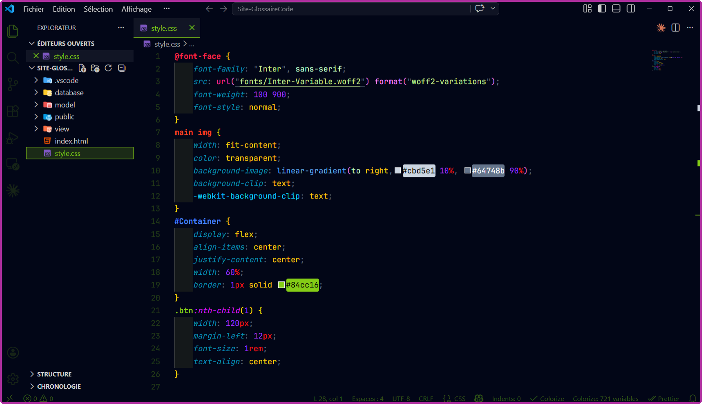
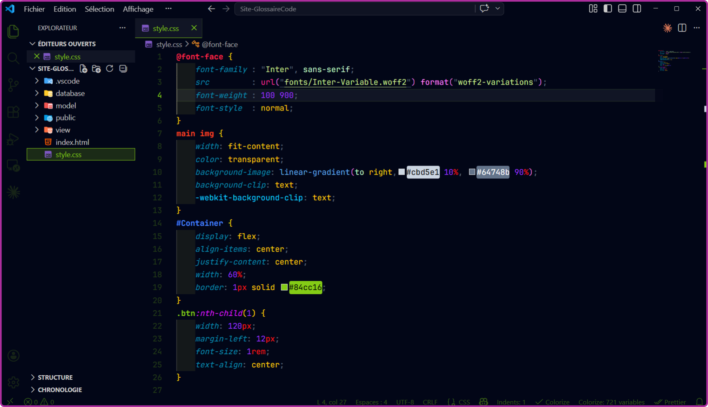
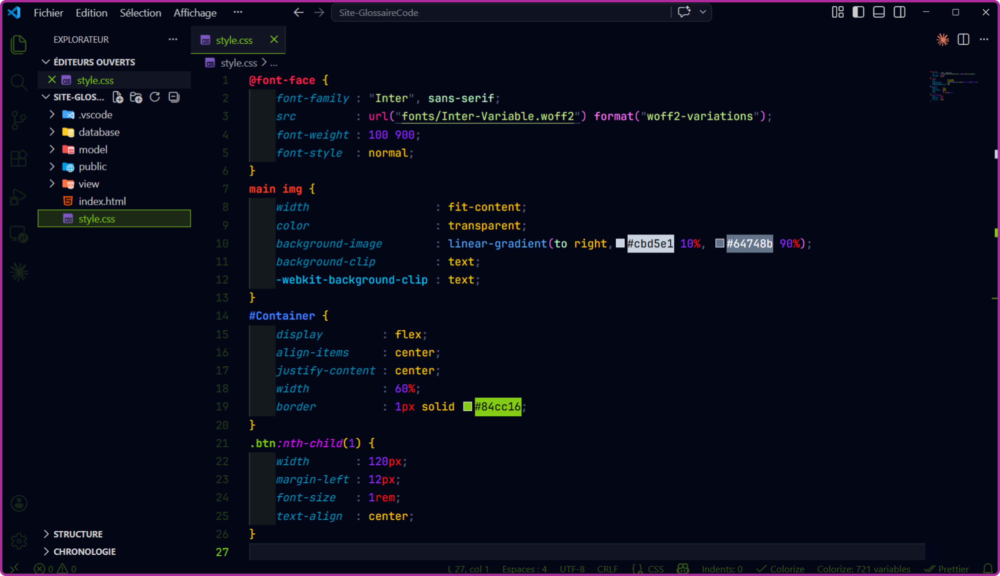

 

  

---

*The information is translated into English below.*

---

 

##  <ins>Traduction française</ins>

 

### ⚡ Aligne ton CSS, JSON et YAML en une seule touche.

**Code plus lisible, lecture plus rapide, gain de temps quotidien.**

 

## 💡 Fonctionnalités

- ⚡ **Aligne un fichier entier** en une seule action avec `Alt+G`
- 🎯 **Aligne un bloc unique** au curseur avec `Alt+C`
- 🌐 **Plusieurs langages supportés** : CSS, SCSS, SASS, LESS, JSON, JSONC, YAML
- ♻️ **Idempotent** : peut être appliquée plusieurs fois sans modifier le résultat
- 📐 **Respecte les niveaux d'indentation**

## 🎯 Utilisation

| Raccourci | Action |
|-----------|--------|
| `Alt+G` | Aligne le **fichier entier** |
| `Alt+C` | Aligne uniquement le **bloc au curseur** |

**Astuce mnémotechnique :**
- **Alt+G** → le **G** de **G**lossCod€ → fichier entier
- **Alt+C** → le **C** de Gloss**C**od€ → bloc au curseur

## 🌐 Langages supportés

- CSS, SCSS, SASS, LESS
- JSON, JSONC
- YAML

 

## 📸 Captures d'écran

### Avant alignement

### Alignement du bloc `@font-face` → `Alt+C`

### Alignement de l'ensemble du fichier → `Alt+G`

 

## 🌐 L'écosystème GlossCod€

- **GlossCod€ Align** → Aligner les propriétés CSS, JSON et YAML
- **GlossCod€ Colors** → Thème de colorisation syntaxique sombre et clair *(bientôt disponible)*
- **GlossCod€ Comments** → Commentaires en couleur sur différents langages *(bientôt disponible)*

🌍 **Site web** : [glosscode.fr](https://www.glosscode.fr) *(en cours de création — lancement prévu pour septembre 2026)*

 

---

 

##  <ins>English translation</ins>

 

### ⚡ Align your CSS, JSON and YAML in a single keystroke.

**More readable code, faster reading, daily time savings.**

 

## 💡 Features

- ⚡ **Align an entire file** in a single action with `Alt+G`
- 🎯 **Align a single block** at the cursor with `Alt+C`
- 🌐 **Multiple supported languages**: CSS, SCSS, SASS, LESS, JSON, JSONC, YAML
- ♻️ **Idempotent**: can be applied multiple times without changing the result
- 📐 **Respects indentation levels**

## 🎯 Usage

| Shortcut | Action |
|----------|--------|
| `Alt+G` | Align the **entire file** |
| `Alt+C` | Align only the **block at cursor** |

**Mnemonic tip:**
- **Alt+G** → the **G** of **G**lossCod€ → whole file
- **Alt+C** → the **C** of Gloss**C**od€ → cursor block

## 🌐 Supported languages

- CSS, SCSS, SASS, LESS
- JSON, JSONC
- YAML

 

## 📸 Screenshots

### Before alignment

### Alignment of the `@font-face` block → `Alt+C`

### Alignment of the entire file → `Alt+G`

 

## 🌐 The GlossCod€ ecosystem

- **GlossCod€ Align** → Align CSS, JSON and YAML properties
- **GlossCod€ Colors** → Dark and light syntax highlighting theme *(coming soon)*
- **GlossCod€ Comments** → Color-coded comments in different languages *(coming soon)*

🌍 **Website**: [glosscode.fr](https://www.glosscode.fr) *(under construction — launch expected for September 2026)*

 

---

 

    <i>Made with ❤️ in France &nbsp;—&nbsp; © 2026 GlossCod€</i>

